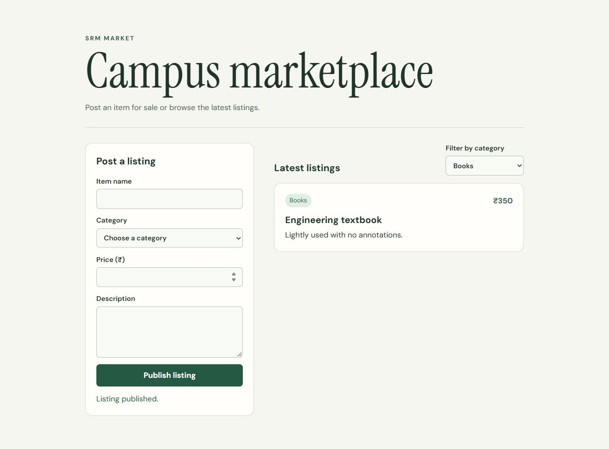

# SRM Market

A full-stack campus marketplace prototype. Use the React interface to publish an item and browse recent listings. Express validates the submission and Mongoose saves it in MongoDB.

[CampusKArt](https://github.com/nayakmanasij-stack/CampusKArt) is the separate deployed marketplace for SRM students.

## Run locally

Use Node.js 20.19+ in the Node.js 20 line, Node.js 22.13+ in the Node.js 22 line, or Node.js 24+. Start MongoDB locally or use a development database you can access.

1. Inside `server`, copy `.env.example` to `.env` and set `MONGO_URI`. The example uses a local MongoDB instance.
2. From `server`, run `npm ci` and `node index.js`. Wait for the MongoDB connection message.
3. In a second terminal, enter `client`, run `npm ci` and `npm run dev`, then open the address Vite prints.
4. Submit an item, then reload the page to check that the listing was saved. Use **Filter by category** to narrow the latest 50 listings shown in the browser.

## How a listing is saved

1. React sends the title, category, price, and description to Express as JSON.
2. Express validates the fields and uses Mongoose to save the listing in MongoDB.
3. React adds the saved item to the list. Reloading the page fetches the latest listings from the API.

The Vite dev server forwards `/api` requests to port 5000. If you change the API port, set `SRM_API_TARGET` when starting Vite. This prototype accepts listings without accounts and is intended for local development. A public deployment should add authentication and route requests from the frontend to the API.

## API

| Request | Response |
| --- | --- |
| `GET /` | API status |
| `GET /api/listings` | Latest 50 listings, newest first |
| `POST /api/listings` | Saves a valid title, category, description, and whole-rupee price. Returns the new listing or a validation error. |

## Checks

Run `npm test` in `server` for listing API tests, and `npm run build` and `npm run lint` in `client`. The API tests use an in-memory stand-in for MongoDB.
